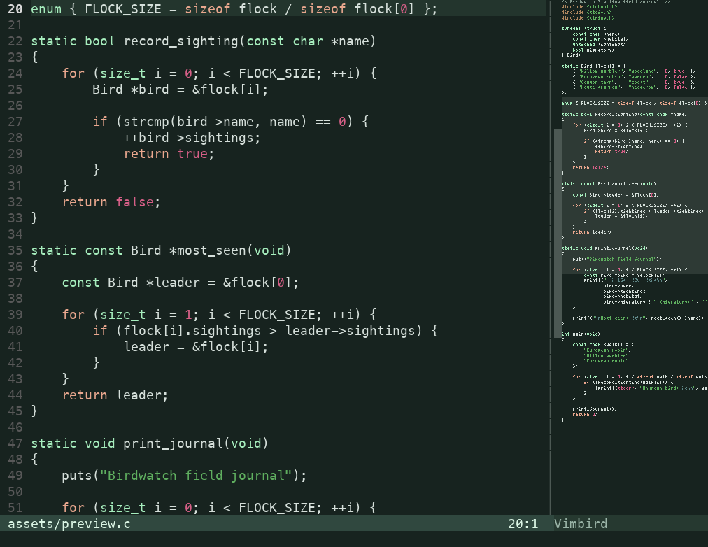

# Vimbird

Vimbird is a graphical code minimap for terminal Vim. It draws miniature text in a right-hand split using the Kitty graphics protocol. A thin vertical rule separates the minimap from the editor, and a one-column track marks the viewport’s position in the full file.

## Preview



## Try it

Use a recent 64-bit terminal Vim 9.1 or newer on Unix or macOS, with `base64_encode()`, Vim9 script, timers, popup windows, and UTF-8. Run Vim directly in Kitty 0.28+ or a terminal with Kitty Unicode placements, such as Ghostty. Vimbird needs true color, which Vim enables with `set termguicolors`.

From the repository root in a supported terminal, try the plugin without changing your vimrc:

```sh
vim --cmd 'set runtimepath^=.' -c 'set termguicolors' -c Vimbird path/to/file
```

To load it permanently, add the repository to your plugin manager or place a checkout in `~/.vim/pack/local/start/vimbird`. Enable `termguicolors` in your vimrc. For another terminal that supports Kitty Unicode placements, launch Vim with `VIMBIRD_KITTY=1`.

| Command | Action |
| --- | --- |
| `:Vimbird` | Open the minimap for the current tab |
| `:VimbirdClose` | Close it |
| `:VimbirdToggle` | Toggle it |
| `:VimbirdRefresh` | Rebuild and resend the bitmap |
| `:VimbirdOverview` | Toggle between the scrolling view and a compressed whole-file overview |
| `:VimbirdStats` | Show build, protocol encoding, terminal write times, and bytes for the latest upload |

To jump to a region, focus the minimap, move to the desired row, and press Enter. The sidebar defaults to 18 cells, including the viewport track. Set `g:vimbird_width` in your vimrc or before opening the minimap. It accepts widths from 3 to 40.

With `set mouse=a`, click the minimap image to jump to that part of the code. Click the track or drag from the minimap to scroll through the whole file. Vimbird installs its Normal-mode mouse bindings when those keys are unmapped.

```vim
let g:vimbird_width = 24
```

The separator defaults to `│` in a muted shade derived from the theme's `Normal` colors. Set it to another single-width character or to an empty string to hide the line. You can also choose an existing highlight group for it.

```vim
let g:vimbird_separator = '│'
let g:vimbird_separator_highlight = 'Comment'
```

With `syntax enable`, the minimap uses the active colorscheme's syntax foregrounds. The viewport tint blends 12% of the theme's foreground into the background by default. Set `g:vimbird_viewport_opacity` to a percentage from 0 to 30. The full-width tint uses the `Normal` background or the background reported by the terminal. To hide the tint and keep the viewport track:

```vim
let g:vimbird_viewport_highlight = 0
```

The track marks where the active Vim search matches while `hlsearch` is active. Set `g:vimbird_search_markers = 0` to hide the marks. The search has a 15 ms budget, so very large files or slow patterns may show partial markers.

Click a search mark to jump to the match nearest the center of that track row. Git marks show additions, modifications, and deletions from GitGutter, GitSigns, or Signify. When those signs are absent, Vimbird reads the tracked file’s on-disk diff against `HEAD` asynchronously. Errors, warnings, and other quickfix entries come from the current quickfix list, the editor window’s location list, and recognized diagnostic signs. Disable either group with `g:vimbird_git_markers = 0` or `g:vimbird_diagnostic_markers = 0`.

`:VimbirdOverview` samples long files to fit the whole file in the sidebar. Click the image or press Enter on a minimap row to jump to that region. Run the command again to return to the one-row-per-line view.

## Rendering

The bitmap matches the terminal’s reported cell dimensions in pixels and uses glyphs sized for the selected density. Terminals that do not report valid pixel dimensions use a 12×24 pixel fallback. It defaults to six source lines per terminal row when the pixel budget permits. Use `g:vimbird_lines_per_cell` to adjust the density. It shows indentation and tab spacing and uses a fallback glyph for characters outside ASCII. The minimap shows a contiguous section of the file, with one miniature row for each source line. The minimap scrolls proportionally with the editor, so the highlighted viewport moves from the top to the bottom as you navigate the file. Edits redraw the minimap after a 75 ms typing pause, and the image is uploaded only when its pixels or palette change. Scrolling within the current section moves the viewport tint and track without uploading the bitmap.

The renderer runs inside Vim and sends an indexed PNG with up to 15 colors plus transparency. Vimbird caches the rendered lines and their PNG blocks around the current view. The cache refreshes when the buffer, theme, or raster settings change. In an 18-column, 42-row synthetic Python benchmark on Apple Silicon, with 20×40 pixel cells, a cold render took about 53 ms, an eight-line shift took about 3.5 ms, and a return to fully cached lines took about 2 ms. These timings exclude terminal transfer and display.

In local Kitty and Ghostty sessions, Vimbird sends a short Kitty command pointing to the PNG in Vim’s private temporary directory. The terminal reads and removes the file. SSH sessions use inline transfers. If the initial file transfer goes unread, Vimbird retries the latest frame inline. Set `g:vimbird_transport = 'direct'` to always send frames inline.

## License

[MIT](LICENSE)
